# Ishin no Arashi: Bakumatsu Shishiden — English Translation

A fan translation of **Ishin no Arashi: Bakumatsu Shishiden** (維新の嵐 幕末志士伝, Koei) for the
PlayStation into English. It is a life simulation set in the last years of the Tokugawa
shogunate (1853-1868): you live through the period as Sakamoto Ryōma, as Hijikata Toshizō of
the Shinsengumi, or as a character of your own, walking the towns of Japan, meeting people,
winning them over in card-based debates, fencing in the dōjō, fighting in the streets and taking
part in the events that led to the Meiji Restoration. The game was only released in Japan.

> **This is a full machine translation.** All of the game's text was translated from
> Japanese by an AI model, not by a human translator, and it has not been
> proofread by a fluent Japanese speaker. Expect occasional mistranslations, awkward
> phrasing and inconsistent terms. Corrections are welcome.

> **This is a beta.** All of the game's text is in English, but only the openings of the three
> stories, free play in Edo and the four practice drills (debate, hanafuda, fencing, battle)
> have been played. Nearly all of the story after the openings has not been seen on screen.
> Expect some text that is squeezed, cut short or wrapped oddly later on.

This repository contains the English text and the tools that build the patch.
It does **not** contain the game, any of its data, or the Japanese script — you need
your own copy of the game.

## Screenshots

| | | |
|:-:|:-:|:-:|
| 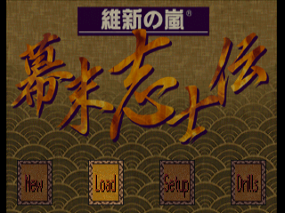 | 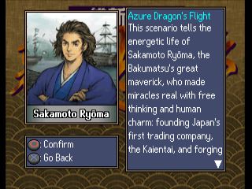 | 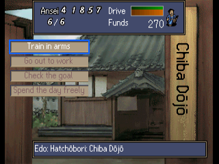 |
| Title | Choosing a hero | Daily menu |
| 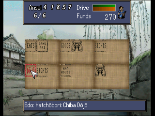 | 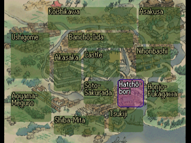 | 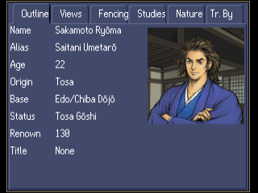 |
| District map | Town map | Status page |
| 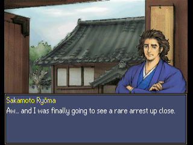 | 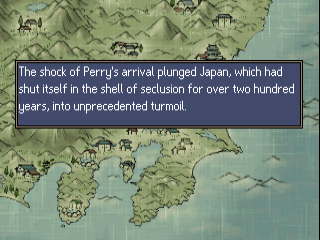 | 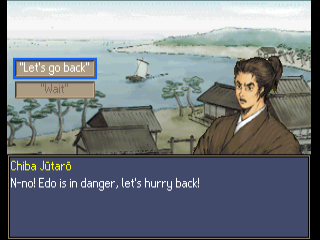 |
| Event dialogue | Narration | Choices |
| 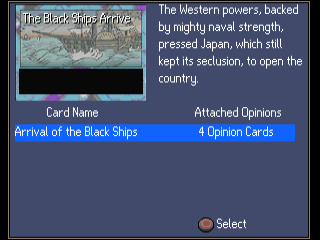 | 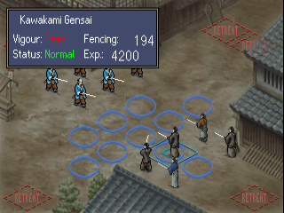 | 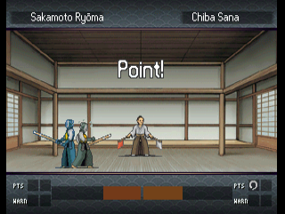 |
| Debate | Battle | Fencing match |

## What's translated

- All event text of the three stories (Sakamoto Ryōma, Hijikata Toshizō, your own character):
  dialogue, narration, choices, goals, map sightseeing lines and battle lines
- All 599 people's names, with macrons (Ryōma, Saigō, Chōshū, Kyōto)
- Menus, the information screens, shops and other buildings, the generic conversation lines,
  the debate (all topic and opinion cards with their descriptions), fencing, street fights and
  battles, hanafuda, save and memory card messages
- English name entry for your own character (letters instead of kana, 10 letters per name)
- Graphics, drawn at build time with original English lettering: title tiles, hero name plates,
  the date bar, the yes / no box, the icon labels, building stamps and district names of the
  maps, ideology tags and charts, fencing banners, battle field marks, dōjō name boards,
  festival lanterns
- A proportional English font (original drawings) with word wrap; long dialogue is split over
  several boxes

Long labels are shortened where the game's boxes are too small.

## Applying the patch (players)

You need:

- **Your own copy of the Japanese disc as a disc image** (serial `SLPM-86144`, the original
  release): four `.bin` files (Track 1 to Track 4) and a `.cue` file. The patch does not contain
  the game.
- **A patching program.** [Delta Patcher](https://github.com/marco-calautti/DeltaPatcher) is
  free and needs no installation.
- **A PlayStation emulator.** The patch was tested in [DuckStation](https://www.duckstation.org/).

Steps:

1. **Download the patch.** Get `Ishin_no_Arashi_Bakumatsu_Shishiden_English_v<version>.zip`
   from the
   [Releases page](https://github.com/damon-daemon/ishin-no-arashi-bakumatsu-shishiden-english/releases)
   and unzip it. Inside are the patch (`.xdelta`), a `.cue` file and a README.txt.
2. **Copy Track 1.** Make a copy of your Track 1 `.bin` file and give the copy exactly this
   name, with the version number of the zip you downloaded (for example `v0.9.0`):

   `Ishin no Arashi - Bakumatsu Shishiden (English v<version>) (Track 1).bin`

   Keep the original file as it is.
3. **Patch the copy.** Open Delta Patcher. Under **Original file** choose the copy you just
   made, under **XDelta patch** choose the `.xdelta` file from the zip, and click
   **Apply patch**.

   If it reports a checksum error, your disc image is not the one the patch was made for:
   compare it with the table below.
4. **Check the names of Tracks 2, 3 and 4.** They must be named exactly
   `Ishin no Arashi - Bakumatsu Shishiden (Japan) (Track 2).bin` (and `(Track 3)`, `(Track 4)`).
   Rename them if yours are named differently. These tracks are the game's CD audio and are
   not changed.
5. **Put five files in one folder:** the patched Track 1, Tracks 2 to 4, and
   `Ishin no Arashi - Bakumatsu Shishiden (English v<version>).cue` from the zip.
6. **Play.** Open that `.cue` file in your emulator.

If the emulator says it cannot find a file, a name in step 2 or 4 does not match exactly.

### Is my disc image the right one?

The patch fits an unmodified image of the Japanese disc. Track 1 must match:

| Track 1 | |
|---|---|
| Size  | 317,174,256 bytes |
| CRC32 | `54EF0762` |
| MD5   | `b32b20b5f43ec90b0d97d4977e3ab530` |
| SHA-1 | `3b6c5a49976b815523c039f3ece63cbdb99e11df` |

| Audio track | Size | CRC32 |
|---|---|---|
| Track 2 | 29,679,888 bytes | `6FE5D0CE` |
| Track 3 | 28,929,600 bytes | `232A02F8` |
| Track 4 | 37,810,752 bytes | `40E86050` |

### Command line

Instead of Delta Patcher (steps 2 and 3) you can use `xdelta3`:

```
xdelta3 -d -s "Ishin no Arashi - Bakumatsu Shishiden (Japan) (Track 1).bin" ishin_shishiden_en_v<version>.xdelta "Ishin no Arashi - Bakumatsu Shishiden (English v<version>) (Track 1).bin"
```

## Building from source

Requirements: Python 3.10+ (standard library only), `xdelta3` (for the patch file).

```
cp "/path/to/Ishin no Arashi - Bakumatsu Shishiden (Japan) (Track 1).bin" ishin_shishiden_track1.bin
cp "/path/to/Ishin no Arashi - Bakumatsu Shishiden (Japan) (Track 2).bin" ishin_shishiden_track2.bin
cp "/path/to/Ishin no Arashi - Bakumatsu Shishiden (Japan) (Track 3).bin" ishin_shishiden_track3.bin
cp "/path/to/Ishin no Arashi - Bakumatsu Shishiden (Japan) (Track 4).bin" ishin_shishiden_track4.bin
python3 tools/setup.py      # checks the disc, extracts its files to extract/
python3 tools/build.py      # writes build/ishin_shishiden_en_track1.bin (+ tracks 2-4, .cue) and the .xdelta
```

`script/`, `extract/` and `build/` hold data from your disc and are never committed.
`python3 tools/package.py <version>` then writes the release zip to `release/`.
No disc data is ever packaged. `requirements.txt` lists the packages of the development
helpers in `tools/dev/` only.

## Repository layout

| Path | Contents |
|---|---|
| `tl/ev/` | English for the event scripts `EVENT/*.I2`, by archive, script and string number |
| `tl/names/` | The people's names |
| `tl/progstr/` | English for strings in the game program and its overlays, by address |
| `tl/stackstr.txt`, `tl/face_titles.txt` | Menu texts the program builds in code; short titles for the debate card face |
| `tl/gfx/` | Wording of the redrawn icon labels |
| `tools/setup.py`, `tools/build.py` | Check the disc and extract; build the patched disc and the patch |
| `tools/tl.py`, `tools/text.py` | Translation checks, wrapping and box splitting |
| `tools/eex.py`, `tools/ls12.py` | Event script format; the `Ls12` archive format |
| `tools/iso.py` | Disc image |
| `tools/names.py` | The person table |
| `tools/progstr.py`, `tools/fmtlimit.py`, `tools/stackstr.py` | Program strings, layout patches; format-string limits; texts built by instructions |
| `tools/vwf.py`, `tools/pixfont.py`, `tools/asm.py` | Proportional font, menu and label centring; small MIPS assembler |
| `tools/grid.py`, `tools/hana.py`, `tools/joins.py`, `tools/facetitle.py`, `tools/nameentry.py` | Name grids, hanafuda tables, joined lists, card face titles, English name entry |
| `tools/gfx.py` | Redrawn graphics |
| `tools/package.py` | Makes the release zip |
| `tools/dev/`, `tools/emu/` | Development helpers (disassembly, DuckStation automation) |
| `docs/screenshots/` | README screenshots |

## Known issues

- The title logo, the movies and writing that is part of the scenery (shop signs, flags) are
  unchanged. The movies have no subtitles in the Japanese game either.
- The staff names in the credits are left in Japanese.
- The name of your own character can only be entered in Latin letters, 10 per name.
- A debate card shows a shortened title on its face where the full title does not fit; lists
  and descriptions use the full title.
- Long names can push list columns to the right, and a few of the longest names are wider than
  their plates.
- Most of the story has not been seen in play. Its text may overflow in places.

Tested in DuckStation only. Bug reports with a screenshot and where it happened are welcome.

## Credits

- Translation and hacking: [damon-daemon](https://github.com/damon-daemon)
- Ishin no Arashi: Bakumatsu Shishiden © Koei Tecmo. This is an unofficial fan project, not
  affiliated with or endorsed by Koei Tecmo. Please support the official releases.

## License

The tools, fonts, documentation and English translation text in this repository
are released under the [MIT License](LICENSE). This covers only original work in
this repository: the game itself and all of its content (code, Japanese text,
graphics, audio) are copyright Koei Tecmo and are not included or licensed here.
